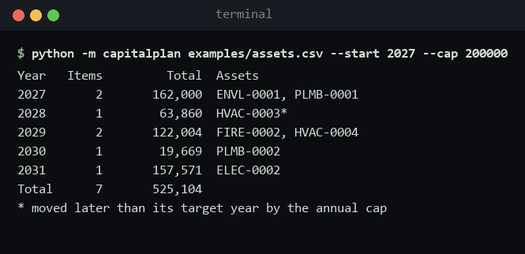

# capital-plan-builder

A capital plan turns an asset list into a budget: what to replace each year, and what it will cost once prices rise. This tool builds a plan of a chosen length (five years by default) from a CSV of assets. It places each asset in its end of life year, pulls Poor condition assets to the first year, grows costs by an inflation rate, and can hold each year under a spending cap by moving lower priority work to later years.



## What it is for

A capital plan turns an asset list into a budget, and the budget has to survive rising prices and a fixed spending limit. Facility managers, capital planners and finance staff use this tool to draft a multi-year replacement plan. They get the assets and the escalated cost for each year, with a mark on any item the spending cap pushed to a later year.

## Install

```
git clone https://github.com/yassine2med/capital-plan-builder
cd capital-plan-builder
pip install -r requirements.txt
```

## How to use

| I want to | Command |
|---|---|
| Build a five year plan from a start year | `PYTHONPATH=src python -m capitalplan examples/assets.csv --start 2027` |
| Hold each year under a spending cap | `PYTHONPATH=src python -m capitalplan examples/assets.csv --start 2027 --cap 200000` |
| Change the plan length (default 5 years) | `--years 8` |
| Change the yearly inflation rate (default 0.03, meaning 3 percent) | `--inflation 0.04` |
| Show help | `PYTHONPATH=src python -m capitalplan --help` |

Input columns: `asset_id`, `name`, `install_year`, `expected_life_years`, `condition` (Good, Fair or Poor), `replacement_cost`. The `--cap` option is optional.

Example:

```
PYTHONPATH=src python -m capitalplan examples/assets.csv --start 2027 --cap 200000
```

Output:

```
Year   Items         Total  Assets
2027       2       162,000  ENVL-0001, PLMB-0001
2028       1        63,860  HVAC-0003*
2029       2       122,004  FIRE-0002, HVAC-0004
2030       1        19,669  PLMB-0002
2031       1       157,571  ELEC-0002
Total      7       525,104
* moved later than its target year by the annual cap
```

Run the tests with `python -m pytest -q`.

## How it works

1. Target year is install year plus expected life, never earlier than the start year. Poor condition assets get the start year.
2. Assets are ranked: Poor first, then earlier target year, then higher cost.
3. For each asset the cost is escalated to the year of spending: cost times (1 + inflation) to the power of years since the start.
4. The asset goes in its target year if the year still has room under the cap. If not, it tries the next year.
5. An asset that fits in no year is listed as unfunded. Assets whose target year is after the plan are left out.
6. A star marks assets the cap moved later than their target year.

## Limits

- Replacement is the only action. No repairs, partial renewals or phased projects.
- One flat inflation rate for all categories.
- The ranking uses condition and age only. It does not score risk, safety or energy savings.

## License

MIT. Yassine Emhamed, 2026.
